# rivet

Rivet is an automation engine for JavaScript repository metadata, SemVer calculation, GitLab workflows, release artifacts, and interactive commit lifecycles.

```text
   ┌───┐    █████  ████ ██   ██ ██████ ██████
  ╱▓▓▓▓▓╲   ██  ██  ██  ██   ██ ██      ██
 │▓█▓▓▓█▓│--█████   ██   ██ ██  █████    ██
  ╲▓▓▓▓▓╱   ██ ██   ██   ██ ██  ██        ██
   └─┼─┘    ██  ██ ████   ███   ██████   ██
     |      |    |  ||     ||    |  |    ||
─────────────────────────────────────────────
```

## Features

- **Conventional Commit SemVer Engine**: Computes exact semantic version increments (`major`, `minor`, `patch`, or `none`) from commit histories using Conventional Commit standards.
- **Manifest Synchronization**: Synchronizes version identities atomically across `package.json`, `jsr.jsonc`, and `package-lock.json`.
- **Clean `.rivet/` Architecture**: Consolidates operational files (`.rivet/repo_config.json`, `.rivet/repo_meta.json`, `.rivet/mr.md`, `.rivet/work-items/*.md`) into a single isolated directory while retaining backwards-compatible root fallback.
- **Work Items & Issue Synchronization**: Bidirectionally synchronizes local structured Markdown work items (`.rivet/work-items/<iid>-<slug>.md`) with GitLab Issues REST API (`pull`, `push`, `list`, `new`).
- **Generic Completion Report Card**: Renders detailed ASCII TUI completion report cards with orange-to-offblack gradient borders, responsive layout, paragraph wrapping, and `-Raw` programmatic output switch for compound workflows (`[MA]`).
- **Runtime Template Initialization**: Scaffolds Node.js/npm and Bun environments (`bunfig.toml`, `bun.lock`) while maintaining `package.json` as the canonical package and script definition.
- **Comprehensive Diagnostics (`doctor`)**: Validates PowerShell version, Git installation, worktree integrity, Git identity (`user.name`/`user.email`), runtime engines (`node`/`bun`), manifest parity, lockfile presence, configuration health, and README heading contracts.
- **Automated Merge Request Management**: Formats table-based merge request documents (`mr.md`), calculates release types in MR titles (`Release (<type>) <Project> <Version>`), creates/updates GitLab MRs, and writes back MR IIDs and web links.
- **Changelog & Release Notes Generation**: Rebuilds release notes from Git tag histories or localized ranges, formatting Conventional Commits into categorized sections with linked hashes and GitLab author references.
- **Interactive Flow Graph Visualization**: Renders ASCII diagrams of the complete Rivet release and automation lifecycle.
- **Static Site Generator Integration**: Exports structured data (`docs/data/changelog.json` and `docs/data/releases.json`) consumable by Hugo, Eleventy (11ty), and Jekyll.
- **Responsive Terminal User Interface (TUI)**: Features an alternate-screen interactive menu (`smenu.ps1`) with layout auto-detection (wide dual-column vs narrow stacked), multi-action indicators (`[MA]`), and truecolor ANSI rendering.

## Repository profiles

Rivet supports JavaScript modules (`jsm`), PowerShell modules (`psm`), and Eleventy themes (`11ty`).
Select the primary release artifact with a top-level `profile` property in `repo_config.json`;
existing configuration without that property continues to use `jsm`.
Shared `project`, `commit`, `tagging`, `readme`, and GitLab settings keep their current structure.

From a consuming repository with the Rivet launcher:

```powershell
./rivet.ps1 init -Profile psm -Manifest src/MyModule.psd1 -DryRun
./rivet.ps1 init -Profile psm -Manifest src/MyModule.psd1
./rivet.ps1 doctor
```

Initialization saves `"profile": "psm"` and `"psm": { "manifest": "src/MyModule.psd1" }`.
Subsequent commands read that selection from configuration. A single module manifest
at the repository root can be inferred; multiple manifests require `-Manifest`.
Initialization preserves existing files and rejects attempts to switch an existing
profile or manifest through initialization options.

The selected profile controls templates, manifest versions, README headers,
repository checks, release checklists, and release-file selection. Git history,
Conventional Commits, work items, tagging policy, and release documentation remain shared.
A PowerShell repository can contain JavaScript documentation tooling without Rivet
updating its JavaScript package versions. One profile represents one primary release
artifact; independently versioned packages in a monorepo are outside this initial scope.

PowerShell version updates change only the literal top-level `ModuleVersion` in the
configured `.psd1`, preserving comments and other manifest data. The updater accepts
stable `major.minor.patch` versions and leaves existing prerelease metadata untouched.
PowerShell README headers are updated only inside `rivet:header` markers; existing
unmarked headers are preserved. New READMEs include those markers and the shared TOC
block. Existing READMEs still need the configured headings and TOC block, or the
corresponding skip switches.

To add another makeup, add `profiles/<name>/profile.ps1` and its templates to the Rivet
installation. No router registration or module export changes are needed. The menu
discovers installed profile folders. See the [profile extension guide](profiles/README.md)
for the handler contract and an example workflow.

## Installation in consuming repositories

Add `rivet.ps1` to the consuming repository root and add `/rivet/` to `.gitignore`. The launcher clones `https://gitlab.com/staticcanvas/rivet.git` on first invocation (or the repository specified by the `RIVET_REPOSITORY_URL` environment variable) and forwards all parameters with the repository root explicitly bound.

```powershell
./rivet.ps1 doctor
./rivet.ps1 menu
./rivet.ps1 prep-release -DryRun
```

Direct module invocation in development environments:

```powershell
./rivet/run.ps1 -RepositoryRoot $PWD status
```

## Repository initialization

### Conceptual

Rivet locates the target repository root through Git, allowing the toolkit to reside at any directory depth. Authoritative project configuration is maintained at the target repository root in `repo_config.json` and `repo_meta.json`. Updating or replacing the rivet clone does not overwrite existing configuration.

Initialization infers namespace, package name, project path, default branch, and display name from the local Git context and remote origin. It creates only missing files and validates configuration syntax without replacing existing files.

When `-Bun` is supplied (or when `bunfig.toml` or `bun.lock` is detected), initialization includes Bun configuration templates (`bunfig.toml`, `bun.lock`) with dynamic package token replacement while keeping `package.json` for scripts and package resolution.

### Strict reference

Initialize default npm configuration:

```powershell
./rivet.ps1 init -DryRun
./rivet.ps1 init
```

Initialize Bun configuration:

```powershell
./rivet.ps1 init -Bun -DryRun
./rivet.ps1 init -Bun
```

Initialize configuration and apply GitLab project metadata:

```powershell
./rivet.ps1 bootstrap -DryRun
./rivet.ps1 bootstrap
```

## Local metadata chores

### Conceptual

Executing `run.ps1` without explicit action switches runs the default metadata maintenance cycle. This process:

1. Calculates the next SemVer version from Conventional Commits after the nearest reachable stable tag.
2. Synchronizes version strings across `package.json` and `jsr.jsonc`.
3. Re-renders the centered HTML metadata block in `README.md` via `jsheader.ps1`.
4. Regenerates the Markdown table of contents within the collapsible `<details>` block via `New-MarkdownTOC.ps1`.
5. Validates that required Markdown headings defined in `readme.requiredHeadings` are present in `README.md`.

When `README-npm.md` exists, Rivet also regenerates its package header from `README-npm.header.md.template`; the package-specific body remains unchanged.

### Strict reference

Execute default metadata maintenance:

```powershell
./rivet.ps1
```

Preview metadata updates without writing files:

```powershell
./rivet.ps1 -DryRun
./rivet.ps1 readme
```

Access parameter documentation via the built-in manual:

```powershell {title="rivet/help.ps1"}
./rivet.ps1 help
./rivet.ps1 help -Param Bun
./rivet.ps1 help -Param Commit
./rivet.ps1 -Help
```

## Interactive command center

### Conceptual

The command center exposes all Rivet workflows through `Show-SMenu`. Operations are categorized into workflow modules:

- **Initialize repository**: Local configuration (npm / Bun) and GitLab metadata bootstrap.
- **Prep Release**: Automated release preparation with preview, apply, and commit stages.
- **Local metadata**: Independent or combined manifest versioning, README and README-npm headers, TOC generation, and heading validation, each with preview/apply control.
- **Release documents**: Draft updates, finalized releases, changelog rebuilding, and JSON exports.
- **Merge request**: `mr.md` generation, GitLab MR creation, and GitLab MR updating.
- **GitLab metadata**: Remote topics, description, and label synchronization.
- **Conventional commit**: Interactive type, scope, subject, file staging, dry-run review, and optional metadata synchronization.
- **Work items and tasks**: Local list/view/scaffold/close/reopen/dashboard actions plus explicit GitLab pull and push controls.
- **Tag and publish**: SemVer release and snapshot tags with preview/apply, version override, and explicit local-tag replacement control.
- **Git history**: Detailed graphical commit history view (`glo`).
- **Repository inspection**: Status, version explanation, diagnostics, and the responsive lifecycle flow graph.
- **Help**: Interactive parameter reference and usage manuals.

The `[MA]` suffix denotes a compound workflow that executes multiple underlying operations. Multi-action labels use a cyan-to-violet-to-magenta three-step gradient; single actions use bold white. Every actionable menu item exposes its CLI equivalent in the details panel, and the command-review screen shows the fully resolved command after prompts are applied. `Show-SMenu` manages the alternate terminal buffer, measures character width before ANSI truecolor encoding, and re-renders dynamically upon terminal resize.

### Strict reference

Launch the interactive command center:

```powershell
./rivet.ps1 menu
./rivet.ps1 -Menu
```

## Release preparation

### Conceptual

`prep-release` coordinates full release staging in one operation:

1. Computes the next version and synchronizes `package.json`, `jsr.jsonc`, and `package-lock.json`.
2. Updates `README.md` header metadata and table of contents.
3. Validates required `README.md` heading structure.
4. Finalizes the dated release section in `CHANGELOG.md` and generates `release-notes.md`.
5. Generates or updates the working merge request document (`mr.md`) with the Conventional Commit bump type in the title (`Release (<type>) <Project> <Version>`).

Passing `-Commit` opens the patch review workflow and automatically stages modified release files from `package.json`, `package-lock.json`, `jsr.jsonc`, `bun.lock`, `bunfig.toml`, `CHANGELOG.md`, `release-notes.md`, `docs/data/changelog.json`, `README.md`, and `README-npm.md`.

### Strict reference

Preview release preparation:

```powershell
./rivet.ps1 prep-release -DryRun
```

Apply release preparation:

```powershell
./rivet.ps1 prep-release
```

Apply release preparation and review commit:

```powershell
./rivet.ps1 prep-release -Commit
```

## Tagging and publishing

### Conceptual

The `-Tag` workflow creates and pushes an annotated Git tag targeting `HEAD`.

- **Production Tags** (default): Generates a tag with the `-release` suffix (e.g. `v1.2.0-release`), triggering production CI publishing pipelines (npm, JSR, Pages, and GitLab Releases).
- **Snapshot Tags** (`-Snapshot`): Generates a plain SemVer tag (e.g. `v1.2.0`) for validation and test pipelines without triggering package publication.

Pre-flight safety requirements enforced prior to tag creation:

1. Working tree must be clean.
2. Local branch must not be behind or diverged from upstream.
3. Manifest versions (`package.json` and `jsr.jsonc`) must match the target tag version.
4. Target tag must not exist locally or on the remote.

If local commits are ahead of upstream, the branch and new tag are pushed atomically.

### Strict reference

Preview production tag creation:

```powershell
./rivet.ps1 -Tag -DryRun
```

Preview validation snapshot tag creation:

```powershell
./rivet.ps1 -Tag -Snapshot -DryRun
```

Create and push an explicit version tag:

```powershell
./rivet.ps1 -Tag -TagVersion 1.2.0
```

## Diagnostics and readiness

### Conceptual

Rivet provides three read-only diagnostic and inspection commands:

- **`doctor` (`Test-RivetRepository`)**: Verifies PowerShell 7+, Git installation, configuration validity, `repo_meta.json` presence, Git worktree state, Git author identity (`user.name`/`user.email`), runtime engines (`node` / `bun`), manifest version parity (`package.json` == `jsr.jsonc`), lockfile presence (`package-lock.json` / `bun.lock`), GitLab token availability, and README structure contracts.
- **`status` (`Write-RivetRepositoryStatus`)**: Displays current branch, commit hash, upstream tracking status, worktree modification count, version baseline, calculated next version, production tag name, and snapshot tag state.
- **`version` (`Write-RivetVersionReport`)**: Analyzes the commit range after the baseline tag, classifying each commit's Conventional Commit bump input.

### Strict reference

```powershell
./rivet.ps1 doctor
./rivet.ps1 status
./rivet.ps1 version
```

## Git history view

### Conceptual

`-glo` (alias for `-GitLog`) is an exclusive read-only history viewer. Each commit is formatted as a single dense record displaying:

- Graph markers and short commit hash.
- Ref decorations (HEAD, branch, tags).
- Commit author name, email, and signature status.
- Relative age and ISO timestamp.
- Commit subject description.
- File modification metrics (files changed, insertions, deletions).

Output includes repository status headers and summary statistics (total commits, authors, merges, signed commits, and changed files).

### Strict reference

Display default history (latest 25 commits):

```powershell
./rivet.ps1 -glo
```

Display custom commit count across all refs excluding merges:

```powershell
./rivet.ps1 -glo -GitLogCount 50 -GitLogAll -GitLogNoMerges
```

## Conventional Commit workflow

### Conceptual

Passing `-Commit` initiates an interactive commit workflow using `Show-SMenu` without clearing the terminal.

1. **Type Selection**: Selects Conventional Commit type (`feat`, `fix`, `docs`, `refactor`, `perf`, `test`, `build`, `ci`, `chore`, `revert`).
2. **Scope Selection**: Selects scope configured in `repo_config.json` (or `none` to omit scope parentheses).
3. **Subject Input**: Prompts for a commit description (enforces maximum 100 characters and removes trailing periods).
4. **File Selection**: Presents changed paths for interactive multi-selection, pre-suggesting files matching scope patterns.
5. **Patch Review**: Displays subject, extracted release note, selected file list, diff totals, and unified patch before staging.
6. **Execution**: Confirms staging and creates the commit. Declining leaves the index and worktree untouched.

### Strict reference

Interactive commit workflow:

```powershell
./rivet.ps1 -Commit
```

Automated non-interactive commit execution:

```powershell
./rivet.ps1 `
  -SkipVersion `
  -SkipReadmeMetadata `
  -SkipTableOfContents `
  -Commit `
  -CommitType feat `
  -CommitScope core `
  -CommitDescription 'add runtime diagnostic checks' `
  -CommitFiles 'scripts/Test-RivetRepository.ps1'
```

## Changelog and release notes

### Conceptual

Release documentation generation parses commits after the latest reachable GitLab release tag.

- Conventional Commit types map to standard headings: `Added` (`feat`), `Fixed` (`fix`), `Changed` (`refactor`, `style`, `build`, `ci`, `chore`, non-conventional subjects), `Deprecated`, `Removed`, and `Security`.
- Scope filtering via `-CommitScope <name>` isolates entries matching a specific subsystem.
- Each entry includes a 7-character Git hash linking to GitLab and an `@username` author reference when mapped in `authors.mappings`.
- Replaces content exclusively between `<!-- rivet:changelog -->` and `<!-- rivet:release-notes -->` markers.
- `rebuild-changelog` iterates chronologically across all Git tags, regenerating `CHANGELOG.md` and `docs/data/changelog.json` across the complete repository history.

### Strict reference

Preview draft changelog updates:

```powershell
./rivet.ps1 -UpdateReleaseDocs -DryRun
```

Finalize release documentation with explicit version and baseline:

```powershell
./rivet.ps1 -FinalizeRelease -ReleaseVersion 1.2.0 -FromTag v1.1.0
```

Rebuild entire changelog history across all tags:

```powershell
./rivet.ps1 rebuild-changelog -DryRun
./rivet.ps1 rebuild-changelog
```

## Merge request document & GitLab automation

### Conceptual

Rivet maintains the working merge request document in `mr.md` (ignored by Git, seeded from `templates/mr.md`).

#### Title & Conventional Commit MR Type Calculation

The MR title is dynamically formatted as `Release (<type>) <Project> <Version>`, where `<type>` is calculated from commits between the baseline tag and `HEAD` using Conventional Commit bump rules (`major`, `minor`, `patch`, or `none`).

#### Markdown Table Metadata

The document header uses structured key-value tables:

- `Gitlab Merge Request IID`
- `Gitlab Merge Link`
- `Generated Date`
- `Commit logs parsed`
- `Title`
- `Source branch`
- `Target branch`

#### GitLab MR Automation

- **Create (`-CreateGitLabMergeRequest`)**: Reads metadata and description from `mr.md`, creates a GitLab MR via the REST API, and automatically writes back the assigned IID (e.g. `!42`) and web URL into `mr.md`.
- **Update (`-UpdateGitLabMergeRequest`)**: Identifies open MRs via stored IID or source/target branch pairs and synchronizes title and description payloads from `mr.md`.

### Strict reference

Update local `mr.md` document:

```powershell
./rivet.ps1 -UpdateMergeRequest
```

Create GitLab merge request and write back IID:

```powershell
./rivet.ps1 -UpdateMergeRequest -CreateGitLabMergeRequest -DryRun
./rivet.ps1 -UpdateMergeRequest -CreateGitLabMergeRequest
```

Update existing GitLab merge request:

```powershell
./rivet.ps1 -UpdateMergeRequest -UpdateGitLabMergeRequest
```

## GitLab project metadata

### Conceptual

Synchronizes remote GitLab project description, topics, and label taxonomies using definitions in `repo_meta.json`.

- Remote operations require `GITLAB_API_KEY` (or the environment variable defined in `gitlab.tokenEnvironmentVariable`).
- Label synchronization creates missing labels, updates matching labels (color and description), and optionally removes unmanaged remote labels when `-DeleteMissingLabels` is passed.

### Strict reference

Preview GitLab metadata synchronization:

```powershell
$env:GITLAB_API_KEY = '<token>'
./rivet.ps1 -SyncGitLabMetadata -DryRun
```

Apply GitLab metadata synchronization:

```powershell
./rivet.ps1 -SyncGitLabMetadata
```

Apply metadata synchronization and purge unmanaged remote labels:

```powershell
./rivet.ps1 -SyncGitLabMetadata -DeleteMissingLabels
```

## Work items and issue synchronization

### Conceptual

Rivet provides local-first issue and work item management stored in `.rivet/work-items/*.md`. This provides complete offline visibility, Git tracking, and optional bidirectional synchronization with GitLab Issues REST API.

#### Work Item Document Format

Each work item is stored as a Markdown document named with its IID and title slug (e.g. `.rivet/work-items/042-implement-responsive-tui.md` or `.rivet/work-items/draft-feature-x.md`), using the standard table format matching `templates/mr.md`:

```markdown
# Rivet Work Item

Rivet Work Item Template `Version 1`

|                        |                                               |
| ---------------------- | --------------------------------------------- |
| **Gitlab Issue IID:**  | `42`                                          |
| **Gitlab Issue Link:** | `https://gitlab.com/example/repo/-/issues/42` |
| **Sync Action:**       | `pull`                                        |
| **Status:**            | `opened`                                      |
| **Created Date:**      | `2026-08-27 21:00:00`                         |
| **Last Updated Date:** | `2026-08-27 21:15:00`                         |
| **Author:**            | `@developer`                                  |
| **Milestone:**         | `v1.2.0`                                      |
| **Labels:**            | `feature, ui`                                 |

> [!Note]
> Set `Sync Action:` to `pull` to refresh this issue from GitLab, or `push` to publish local changes to GitLab.

---

|        |                                   |
| ------ | --------------------------------- |
| Title: | `Implement responsive TUI layout` |

## **Description**

Provide automatic dual-column layout on wide terminals.

## **Acceptance Criteria**

- [ ] Columns switch dynamically when terminal width exceeds 110 characters.
- [ ] Viewport height gracefully contracts when console rows decrease.

## **Technical Notes**

- Memory and layout caching managed via `rivet_cache.ps1`.
```

#### Sync Operations & Task Management

- **`List` (`rivet tasks` / `rivet work-items`)**: Scans local `.rivet/work-items/` and renders a clean TUI summary table displaying IID, sync direction (`[PULL]` / `[PUSH]`), state badge (`[OPEN]` / `[CLOSED]`), title, and labels.
- **`View` (`rivet work-items -View -Iid 42`)**: Displays full work item details, description, acceptance criteria, and notes formatted in console.
- **`Close` (`rivet work-items -Close -Iid 42`)**: Closes a work item locally, flags it for push sync (`Sync Action: push`), and regenerates the `.rivet/workitems-list.md` task tracker.
- **`Reopen` (`rivet work-items -Reopen -Iid 42`)**: Reopens a closed work item, flags it for push sync, and regenerates the task tracker.
- **`Template` / `New` (`rivet work-items -Template -Iid 42`)**: Scaffolds a new work item template with metadata tables. If an IID is supplied, it defaults `Sync Action: pull` so running pull downloads only that issue.
- **`Pull` (`rivet work-items -PullIssues -Iid 42`)**: When an IID is supplied (or when local items are marked `Sync Action: pull`), fetches _only those targeted work items and discussion notes_ from GitLab via REST API.
- **`Push` (`rivet work-items -PushIssues`)**: Scans local files and publishes only items marked `Sync Action: push` to GitLab, updating remote issue title, description, and state, and resetting `Sync Action` to `pull`.
- **`GenerateList` (`rivet tasklist` / `rivet work-items -GenerateList`)**: Rebuilds the aggregated `.rivet/workitems-list.md` dashboard index from local work items.

### Strict reference

List all local tasks / work items:

```powershell
./rivet.ps1 tasks
./rivet.ps1 work-items
```

View a specific work item in terminal:

```powershell
./rivet.ps1 work-items -View -Iid 42
```

Close or reopen an issue locally:

```powershell
./rivet.ps1 work-items -Close -Iid 42
./rivet.ps1 work-items -Reopen -Iid 42
```

Scaffold a new local work item template targeting issue #42:

```powershell
./rivet.ps1 work-items -Template -Iid 42 -IssueTitle 'Add completion report card' -IssueLabels 'feature','ui'
```

Pull only a specific issue (#42) from GitLab:

```powershell
./rivet.ps1 work-items -PullIssues -Iid 42
```

Push modified local work items marked with `Sync Action: push`:

```powershell
./rivet.ps1 work-items -PushIssues -DryRun
./rivet.ps1 work-items -PushIssues
```

Regenerate aggregated task tracker dashboard:

```powershell
./rivet.ps1 tasklist
./rivet.ps1 work-items -GenerateList
```

## Generic CLI & API caching engine (`rivet_cache.ps1`)

### Conceptual

Rivet includes a standalone, high-performance, zero-dependency caching utility (`scripts/helpers/cache/rivet_cache.ps1`) purpose-built for CLI and API applications to reduce remote endpoint load and capture operational telemetry:

- **Tiered Storage**: Supports fast in-memory caching with persistent file-backed JSON storage under `.rivet/cache/`.
- **TTL Expiration**: Configurable Time-To-Live duration per entry or global default (e.g. 15 minutes for issues, 1 hour for metadata).
- **Tag-Based Invalidation**: Invalidate groups of cached entries by tag (e.g. `Remove-RivetCache -Tag gitlab_issues`).
- **Telemetry & Metrics**: Tracks requests, cache hits, misses, hit-rate percentage, average read/write duration in milliseconds, and total disk storage in bytes via `Get-RivetCacheMetrics`.
- **Execution Wrapper**: `Invoke-RivetCachedOperation -Key <key> -TtlSeconds 300 -ScriptBlock { ... }` simplifies caching around any arbitrary API call or script block.

### Strict reference

```powershell
. ./scripts/helpers/cache/rivet_cache.ps1
Initialize-RivetCache -CacheDirectory ./.rivet/cache -DefaultTtlSeconds 1800
$user = Invoke-RivetCachedOperation -Key 'gl_user_42' -TtlSeconds 900 -ScriptBlock {
    Invoke-RestMethod -Uri 'https://gitlab.com/api/v4/users/42'
}
$metrics = Get-RivetCacheMetrics
```

## Generic completion report card and pipeline reporting

### Conceptual

Rivet implements a zero-tear ASCII TUI completion report card (`Write-RivetReportCard.ps1`) for all CLI actions and multi-action workflows (`[MA]`):

- **Orange-to-Offblack Gradient Borders**: Renders clean rounded borders with truecolor RGB transitions (`RGB(255, 130, 0)` -> `RGB(40, 44, 54)`).
- **Responsive Width Adaptation**: Automatically adjusts box width to terminal size while preserving strict inner line wrapping.
- **Word-Boundary Paragraph Wrapping**: Long execution details and metadata items wrap cleanly at word boundaries using `Split-SMenuText`.
- **Status Badging**: Visual status indicators (`[SUC]`, `[ACT]`, `[SKIP]`, `[FAIL]`, `[WRN]`, `[INF]`).
- **Compound Action Support (`-Raw`)**: Subroutines inside compound workflows (`PrepRelease`, `Bootstrap`, `Init`, `RebuildChangelog`) pass `-Raw` to suppress intermediate inner report cards and emit one unified report card at completion. Passing `-Raw` at the CLI returns a structured `[pscustomobject]` report data model for scripting and CI pipelines.

### Strict reference

Execute release preparation with formatted visual report card:

```powershell
./rivet.ps1 prep-release -DryRun
```

Execute release preparation in silent raw data mode:

```powershell
$result = ./rivet.ps1 prep-release -Raw -DryRun
$result.Success
$result.Rows
```

## Static site generator integration (Hugo, 11ty, Jekyll)

### Conceptual

Rivet outputs machine-readable JSON data consumable by static site generators:

- **`docs/data/changelog.json`**: Generated during release document operations (`-UpdateChangelogJson` or `rebuild-changelog`). Contains structured records for all versions, entries, scopes, commit URLs, and author metadata.
- **`docs/data/releases.json`**: Catalogues tagged releases, archive links, and compiled asset artifacts.

### Hugo

Hugo loads JSON files located in `docs/data/` directly into `site.Data`.

```html {title="layouts/shortcodes/changelog-data.html"}
{{ with site.Data.changelog }}
<div class="changelog-data" data-changelog-source="{{ .source.canonical_record }}">
  {{ range .versions }} {{ $version := . }}
  <section class="changelog-release" aria-labelledby="changelog-{{ .version | anchorize }}">
    <header>
      <h2 id="changelog-{{ .version | anchorize }}">
        {{ if eq .version "unreleased" }}Unreleased{{ else }}{{ .version }}{{ end }}
      </h2>
      {{ with .date }}<time datetime="{{ . }}">{{ . }}</time>{{ end }}
    </header>
    {{ if .entries }} {{ range $category := slice "Added" "Changed" "Deprecated" "Removed" "Fixed"
    "Security" }} {{ $categoryEntries := where $version.entries "category" $category }} {{ if
    $categoryEntries }}
    <h3>{{ $category }}</h3>
    <ul>
      {{ range $categoryEntries }}
      <li>
        <span>{{ .text }}</span>
        {{ with .scope }}<code>{{ . }}</code>{{ end }}
        <a href="{{ .commit.url }}">{{ .commit.short }}</a>
        {{ with .author.reference }}<span class="changelog-author">{{ . }}</span>{{ end }}
      </li>
      {{ end }}
    </ul>
    {{ end }} {{ end }} {{ else }}
    <p>No changelog notes are recorded for this version.</p>
    {{ end }}
  </section>
  {{ end }}
</div>
{{ end }}
```

### Eleventy (11ty)

Eleventy exposes files in the global data directory (`_data/` or mapped `docs/data/`) to Nunjucks and Liquid templates.

```html {title="changelog.njk"}
<div class="changelog-data">
  
  <section class="changelog-release">
    <h2>{{ release.version }}</h2>
    <time datetime="{{ release.date }}">{{ release.date }}</time>
    <ul>
      
      <li>
        <span>{{ item.text }}</span>
        <code>{{ item.scope }}</code>
        <a href="{{ item.commit.url }}">{{ item.commit.short }}</a>
        <span>{{ item.author.reference }}</span>
      </li>
      
    </ul>
  </section>
  
</div>
```

### Jekyll

Jekyll parses `_data/changelog.json` into `site.data.changelog`.

```html {title="_includes/changelog.html"}
<div class="changelog-data">
  
  <section class="changelog-release">
    <h2>{{ release.version }}</h2>
    <time datetime="{{ release.date }}">{{ release.date }}</time>
    <ul>
      
      <li>
        <span>{{ item.text }}</span>
        <code>{{ item.scope }}</code>
        <a href="{{ item.commit.url }}">{{ item.commit.short }}</a>
        <span>{{ item.author.reference }}</span>
      </li>
      
    </ul>
  </section>
  
</div>
```

## Architecture and layout

### Directory Structure

```text
rivet/
├── README.md
├── rivet.psd1            # Versioned module manifest
├── rivet.psm1            # Runtime loader and public export boundary
├── help.ps1               # Terminal manual and parameter lookup
├── run.ps1                # Positional CLI router and runner entry point
├── templates/
│   ├── mr.md              # Template for working merge request document
│   └── js/                # Standard JavaScript, Bun, CI, and config templates
├── tests/
│   └── Rivet.Tests.ps1   # Pester unit and integration test suite
└── scripts/
    ├── helpers/           # Internal helper libraries
    │   ├── data_utils/
    │   │   └── Resolve-RivetPath.ps1
    │   ├── ui/
    │   │   └── Write-RivetReportCard.ps1
    │   └── flowgraph/     # Flowgraph rendering engine
    ├── Get-RivetConfiguration.ps1
    ├── Get-ConventionalCommitVersion.ps1
    ├── Initialize-RivetRepository.ps1
    ├── Invoke-RivetMenu.ps1
    ├── Invoke-RepositoryCommit.ps1
    ├── Invoke-RepositoryTag.ps1
    ├── Invoke-GitLabMergeRequest.ps1
    ├── Sync-RivetWorkItems.ps1
    ├── New-MarkdownTOC.ps1
    ├── asciitokenizer.ps1
    ├── lazylog.ps1
    ├── smenu.ps1
    ├── Update-JSLibSemver.ps1
    ├── Update-ReleaseDocumentation.ps1
    ├── Update-MergeRequestDocumentation.ps1
    ├── Write-PrettyGitLog.ps1
    ├── Write-RivetRepositoryStatus.ps1
    ├── Write-RivetVersionReport.ps1
    ├── Test-RivetRepository.ps1
    ├── Test-ReadmeStructure.ps1
    ├── jsheader.ps1
    └── Sync-GitLabRepositoryMetadata.ps1

.rivet/                    # Consuming repository automation directory
├── repo_config.json       # Project identity, paths, and contracts
├── repo_meta.json         # Project description, topics, and label catalogs
├── mr.md                  # Working merge request document
└── work-items/            # Local structured Markdown work items
    └── *.md               # Individual issue specifications with frontmatter
```

### Script Responsibilities

| Script                                                                                 | Type          | Responsibility                                                                                        |
| -------------------------------------------------------------------------------------- | ------------- | ----------------------------------------------------------------------------------------------------- |
| [`run.ps1`](run.ps1)                                                                   | Entry         | Primary CLI orchestrator, parameter routing, and LazyLog reporting.                                   |
| [`rivet.psd1`](rivet.psd1)                                                             | Manifest      | Declares module metadata and exported command surface.                                                |
| [`rivet.psm1`](rivet.psm1)                                                             | Loader        | Dot-sources runtime helper allow-list and controls public visibility.                                 |
| [`help.ps1`](help.ps1)                                                                 | Manual        | Renders formatted terminal manual and parameter documentation.                                        |
| [`Resolve-RivetPath.ps1`](scripts/helpers/data_utils/Resolve-RivetPath.ps1)            | Helper        | Resolves canonical `.rivet/` artifact paths with transparent fallback to repository root.             |
| [`Write-RivetReportCard.ps1`](scripts/helpers/ui/Write-RivetReportCard.ps1)            | UI Engine     | Renders non-tear ASCII TUI completion report cards with orange gradient borders and `-Raw` support.   |
| [`Sync-RivetWorkItems.ps1`](scripts/Sync-RivetWorkItems.ps1)                           | Engine        | Manages local `.rivet/work-items/*.md` and bidirectional synchronization with GitLab Issues REST API. |
| [`Initialize-RivetRepository.ps1`](scripts/Initialize-RivetRepository.ps1)             | Engine        | Scaffolds `.rivet/` configuration and templates for npm or Bun environments.                          |
| [`Test-RivetRepository.ps1`](scripts/Test-RivetRepository.ps1)                         | Diagnostics   | Executes read-only validation of tooling, runtimes, Git identity, manifests, and contracts.           |
| [`Get-ConventionalCommitVersion.ps1`](scripts/Get-ConventionalCommitVersion.ps1)       | Engine        | Computes SemVer increments from commit history.                                                       |
| [`Update-JSLibSemver.ps1`](scripts/Update-JSLibSemver.ps1)                             | Engine        | Synchronizes version strings in `package.json`, `jsr.jsonc`, and `package-lock.json`.                 |
| [`Update-ReleaseDocumentation.ps1`](scripts/Update-ReleaseDocumentation.ps1)           | Engine        | Generates marker-bounded changelogs and release notes.                                                |
| [`Update-MergeRequestDocumentation.ps1`](scripts/Update-MergeRequestDocumentation.ps1) | Engine        | Generates `mr.md` with Conventional Commit bump type in the title.                                    |
| [`Invoke-GitLabMergeRequest.ps1`](scripts/Invoke-GitLabMergeRequest.ps1)               | Integration   | Creates and updates GitLab MRs, writing back assigned IIDs and web links.                             |
| [`Invoke-RepositoryCommit.ps1`](scripts/Invoke-RepositoryCommit.ps1)                   | Workflow      | Interactively reviews, stages, and commits Conventional Commits.                                      |
| [`Invoke-RepositoryTag.ps1`](scripts/Invoke-RepositoryTag.ps1)                         | Workflow      | Validates, creates, and pushes annotated release or snapshot tags.                                    |
| [`Write-PrettyGitLog.ps1`](scripts/Write-PrettyGitLog.ps1)                             | Inspection    | Formats dense terminal Git history with summary statistics.                                           |
| [`Show-RivetFlowGraph.ps1`](scripts/Show-RivetFlowGraph.ps1)                           | Visualization | Renders interactive ASCII pipeline lifecycle flow graphs using the Flowgraph engine.                  |
| [`smenu.ps1`](scripts/smenu.ps1)                                                       | UI Engine     | Terminal UI selection engine with responsive layouts and truecolor ANSI rendering.                    |
| [`Sync-GitLabRepositoryMetadata.ps1`](scripts/Sync-GitLabRepositoryMetadata.ps1)       | Integration   | Synchronizes project description, topics, and labels to GitLab REST API.                              |

### Execution Workflow

```mermaid
flowchart TD
    A[run.ps1] --> B[Calculate Conventional Commit SemVer]
    A --> C[Render centered README header]
    A --> D[Regenerate README TOC]
    A -->|prep-release| PREP[Stage full release metadata]
    A -->|init / bootstrap| INIT[Scaffold npm / Bun templates]
    A -->|doctor| DOC[Execute diagnostic health checks]
    A -->|work-items| WORK[Sync / Manage local work items & issues]
    A -->|rebuild-changelog| REBUILD[Rebuild changelog across all tags]
    A -->|explicit switch| L[Generate release documentation]
    A -->|explicit switch| O[Generate merge request mr.md]
    A -->|explicit switch| MR_API[Create or Update GitLab MR]
    A -->|explicit switch| E[Sync GitLab project metadata]
    A -->|explicit switch| Q[Review Conventional Commit]
    A -->|glo mode| T[Render dense Git history]
    A -->|menu mode| U[Open interactive command center]
    U --> V[Select workflow options]
    V --> W[Review exact CLI command]
    W -->|execute| A
    B --> F[package.json]
    B --> G[jsr.jsonc]
    B --> PL[package-lock.json]
    C --> H[README.md]
    D --> H
    L --> M[CHANGELOG.md]
    L --> N[release-notes.md]
    L --> CJ[docs/data/changelog.json]
    O --> P[.rivet/mr.md]
    MR_API -->|write back IID & link| P
    WORK --> WI[.rivet/work-items/*.md]
    WORK <--> GL_ISSUES[GitLab Issues REST API]
    INIT -->|Bun switch| BUN[bunfig.toml & bun.lock]
    INIT --> F
    INIT --> RIVET_DIR[.rivet/ directory]
    E --> I[.rivet/repo_config.json]
    E --> J[.rivet/repo_meta.json]
    I --> K[GitLab API: description, topics, labels]
    J --> K
    Q -->|confirmed| R[Stage reviewed paths]
    R --> S[Create Git commit]
    A -->|tag mode| X[Validate worktree, upstream, manifests]
    X -->|valid and confirmed| Y[Create annotated Git tag]
    Y --> Z[Push branch & tag atomically]
```



## API Reference

| Parameter                         | Type       | Default      | Description                                                                                                                                                                                                                          |
| --------------------------------- | ---------- | ------------ | ------------------------------------------------------------------------------------------------------------------------------------------------------------------------------------------------------------------------------------ |
| `Command`                         | `string`   | unset        | Positional command: `help`, `menu`, `init`, `bootstrap`, `prep-release`, `doctor`, `status`, `version`, `readme`, `commit`, `tag`, `history`, `glo`, `rebuild-changelog`, `flow`, `pipeline`, `work-items`, `issues`, `sync-issues`. |
| `Help`                            | `switch`   | `false`      | Displays terminal manual overview and exits.                                                                                                                                                                                         |
| `Menu`                            | `switch`   | `false`      | Launches the interactive TUI command center.                                                                                                                                                                                         |
| `Init`                            | `switch`   | `false`      | Scaffolds missing `.rivet/` configuration from templates without replacing existing files.                                                                                                                                           |
| `Bootstrap`                       | `switch`   | `false`      | Scaffolds configuration and synchronizes GitLab project metadata.                                                                                                                                                                    |
| `Bun`                             | `switch`   | `false`      | Includes Bun runtime templates (`bunfig.toml`, `bun.lock`) during initialization.                                                                                                                                                    |
| `PrepRelease`                     | `switch`   | `false`      | Executes full release preparation (manifests, README, changelog, release notes, `mr.md`).                                                                                                                                            |
| `Doctor`                          | `switch`   | `false`      | Executes read-only repository, tooling, runtime, Git identity, manifest, and contract validation.                                                                                                                                    |
| `Status`                          | `switch`   | `false`      | Displays read-only repository state, upstream tracking, version, and tag status.                                                                                                                                                     |
| `VersionReport`                   | `switch`   | `false`      | Outputs baseline tag, commit range, and per-commit Conventional Commit bump inputs.                                                                                                                                                  |
| `ValidateReadme`                  | `switch`   | `false`      | Executes required-heading contract verification against `README.md`.                                                                                                                                                                 |
| `FlowGraph` / `Flow` / `Pipeline` | `switch`   | `false`      | Renders interactive ASCII Flowgraph of Rivet automation lifecycle.                                                                                                                                                                   |
| `WorkItems` / `Issues`            | `switch`   | `false`      | Manages local work items and connects to GitLab Issues API.                                                                                                                                                                          |
| `SyncWorkItems`                   | `switch`   | `false`      | Synchronizes local work items with remote GitLab issues.                                                                                                                                                                             |
| `PullIssues`                      | `switch`   | `false`      | Pulls remote GitLab issues into local `.rivet/work-items/`.                                                                                                                                                                          |
| `PushIssues`                      | `switch`   | `false`      | Pushes local `.rivet/work-items/` to remote GitLab issues.                                                                                                                                                                           |
| `ListIssues`                      | `switch`   | `false`      | Lists local work items in a formatted TUI table.                                                                                                                                                                                     |
| `NewIssue`                        | `switch`   | `false`      | Scaffolds a new local work item template in `.rivet/work-items/`.                                                                                                                                                                    |
| `IssueTitle`                      | `string`   | unset        | Title for a new or updated work item.                                                                                                                                                                                                |
| `IssueDescription`                | `string`   | unset        | Body description for a new or updated work item.                                                                                                                                                                                     |
| `IssueLabels`                     | `string[]` | unset        | Label taxonomy for a new or updated work item.                                                                                                                                                                                       |
| `HelpParameter` / `Param`         | `string`   | unset        | Displays detailed documentation for a specific parameter or alias.                                                                                                                                                                   |
| `SkipVersion`                     | `switch`   | `false`      | Skips SemVer version calculation and package manifest synchronization.                                                                                                                                                               |
| `SkipReadmeMetadata`              | `switch`   | `false`      | Skips centered `README.md` header generation.                                                                                                                                                                                        |
| `SkipTableOfContents`             | `switch`   | `false`      | Skips canonical `README.md` table of contents generation.                                                                                                                                                                            |
| `SkipReadmeValidation`            | `switch`   | `false`      | Skips required-heading contract validation during multi-action runs.                                                                                                                                                                 |
| `UpdateReleaseDocs`               | `switch`   | `false`      | Updates marker-bounded draft changelog and release notes.                                                                                                                                                                            |
| `FinalizeRelease`                 | `switch`   | `false`      | Finalizes release documentation under the dated version heading.                                                                                                                                                                     |
| `RebuildChangelog` / `Rebuild`    | `switch`   | `false`      | Rebuilds `CHANGELOG.md` and `docs/data/changelog.json` across all Git tags from history.                                                                                                                                             |
| `UpdateChangelogJson`             | `switch`   | `false`      | Generates structured `docs/data/changelog.json` projection from `CHANGELOG.md`.                                                                                                                                                      |
| `UpdateMergeRequest`              | `switch`   | `false`      | Generates or updates `mr.md` with Conventional Commit bump type in the title.                                                                                                                                                        |
| `CreateGitLabMergeRequest`        | `switch`   | `false`      | Creates GitLab MR from `mr.md` and writes back assigned IID and URL.                                                                                                                                                                 |
| `UpdateGitLabMergeRequest`        | `switch`   | `false`      | Updates matching open GitLab MR title and description from `mr.md`.                                                                                                                                                                  |
| `ReleaseVersion`                  | `string`   | calculated   | Overrides version string displayed in generated release documents.                                                                                                                                                                   |
| `FromTag`                         | `string`   | baseline ref | Overrides baseline Git ref for release notes and changelog parsing.                                                                                                                                                                  |
| `MergeTargetBranch`               | `string`   | `main`       | Specifies target branch recorded in generated `mr.md`.                                                                                                                                                                               |
| `IncludeCommitHash`               | `switch`   | `true`       | Appends linked short commit hashes to generated change items (`:$false` to omit).                                                                                                                                                    |
| `IncludeAuthor`                   | `switch`   | `true`       | Appends author mentions to generated change items (`:$false` to omit).                                                                                                                                                               |
| `SyncGitLabMetadata`              | `switch`   | `false`      | Synchronizes project description, topics, and managed labels to GitLab.                                                                                                                                                              |
| `DeleteMissingLabels`             | `switch`   | `false`      | Purges remote GitLab labels not present in `repo_meta.json` during sync.                                                                                                                                                             |
| `Commit`                          | `switch`   | `false`      | Opens interactive Conventional Commit staging and review workflow.                                                                                                                                                                   |
| `CommitType`                      | `string`   | interactive  | Sets Conventional Commit type (`feat`, `fix`, `docs`, etc.).                                                                                                                                                                         |
| `CommitScope`                     | `string`   | interactive  | Sets Conventional Commit scope (`core`, `cli`, `ui`, `none`, etc.).                                                                                                                                                                  |
| `CommitDescription`               | `string`   | interactive  | Sets commit subject description line.                                                                                                                                                                                                |
| `CommitFiles`                     | `string[]` | interactive  | Explicit list of repository-relative paths to stage and commit.                                                                                                                                                                      |
| `CommitAll`                       | `switch`   | `false`      | Selects all modified repository paths for commit review.                                                                                                                                                                             |
| `Tag`                             | `switch`   | `false`      | Executes reviewed Git tag creation and push workflow.                                                                                                                                                                                |
| `Snapshot`                        | `switch`   | `false`      | Creates plain SemVer tag (`v1.0.0`) without `-release` suffix; requires `Tag`.                                                                                                                                                       |
| `TagForce`                        | `switch`   | `false`      | Bypasses final interactive tag confirmation prompt while enforcing all safety checks.                                                                                                                                                |
| `TagVersion`                      | `string`   | calculated   | Overrides version string for tag creation; requires `Tag`.                                                                                                                                                                           |
| `GitLog` / `glo`                  | `switch`   | `false`      | Executes dense read-only graphical Git commit history viewer.                                                                                                                                                                        |
| `GitLogCount`                     | `integer`  | `25`         | Sets maximum commit count displayed in history (range 1-500).                                                                                                                                                                        |
| `GitLogAll`                       | `switch`   | `false`      | Traverses commits reachable from all local and remote refs.                                                                                                                                                                          |
| `GitLogNoMerges`                  | `switch`   | `false`      | Omits merge commits from history output.                                                                                                                                                                                             |
| `RepositoryRoot`                  | `string`   | current dir  | Path to target consuming Git repository root directory.                                                                                                                                                                              |
| `ConfigPath`                      | `string`   | root config  | Explicit path to `repo_config.json` configuration file.                                                                                                                                                                              |
| `DryRun`                          | `switch`   | `false`      | Simulates actions and previews outputs without writing files or remote APIs.                                                                                                                                                         |
| `Raw`                             | `switch`   | `false`      | Suppresses visual TUI report cards and returns structured data objects.                                                                                                                                                              |
| `GITLAB_API_KEY`                  | env var    | unset        | Environment variable containing GitLab API personal/project access token.                                                                                                                                                            |

## Configuration Reference

| File               | Property                          | Type       | Description                                                                                                            |
| ------------------ | --------------------------------- | ---------- | ---------------------------------------------------------------------------------------------------------------------- |
| `repo_config.json` | `profile` | `string` | Installed repository makeup; defaults to `jsm` when absent. |
| `repo_config.json` | `psm.manifest` | `string` | Repository-relative PowerShell module manifest path, required for `psm`. |
| `repo_config.json` | `project`                         | `object`   | Defines project name, display name, namespace, project paths, default branch, package names, banner URL, and docs URL. |
| `repo_config.json` | `readmeHeader`                    | `object`   | Controls header alignment (`left`/`center`), badge styling, hex colors, and Codecov token.                             |
| `repo_config.json` | `readme.requiredHeadings`         | `object[]` | Array of required Markdown heading level and name objects (`level`, `name`) validated by `doctor` and `readme`.        |
| `repo_config.json` | `commit.defaultType`              | `string`   | Default Conventional Commit type pre-selected in interactive menus.                                                    |
| `repo_config.json` | `commit.defaultScope`             | `string`   | Default Conventional Commit scope pre-selected in interactive menus.                                                   |
| `repo_config.json` | `commit.defaultDescription`       | `string`   | Fallback commit description when prompt is accepted without input.                                                     |
| `repo_config.json` | `authors.mappings`                | `array`    | Maps Git author emails to GitLab usernames for profile link generation.                                                |
| `repo_config.json` | `commit.types`                    | `object[]` | Catalog of allowed Conventional Commit types with descriptions.                                                        |
| `repo_config.json` | `commit.scopes`                   | `object[]` | Catalog of allowed commit scopes with associated file path matching patterns.                                          |
| `repo_config.json` | `tagging.prefix`                  | `string`   | Prefix prepended to SemVer release tags (default: `v`).                                                                |
| `repo_config.json` | `tagging.releaseSuffix`           | `string`   | Suffix appended to production release tags (default: `-release`).                                                      |
| `repo_config.json` | `tagging.remote`                  | `string`   | Target Git remote name receiving published tags (default: `origin`).                                                   |
| `repo_config.json` | `gitlab.apiUrl`                   | `string`   | GitLab REST API endpoint base URI (e.g. `https://gitlab.com/api/v4`).                                                  |
| `repo_config.json` | `gitlab.projectId`                | `string`   | URL-encoded or numerical GitLab project path/identifier.                                                               |
| `repo_config.json` | `gitlab.tokenEnvironmentVariable` | `string`   | Name of the environment variable providing the GitLab access token (default: `GITLAB_API_KEY`).                        |
| `repo_config.json` | `metadataSource`                  | `string`   | Relative path from `repo_config.json` to project metadata catalog (default: `repo_meta.json`).                         |
| `repo_config.json` | `labelScope`                      | `string`   | Scope for managed GitLab labels (`project`).                                                                           |
| `repo_config.json` | `requestTimeoutSeconds`           | `integer`  | Timeout in seconds for GitLab REST API HTTP requests.                                                                  |
| `repo_meta.json`   | `project.description`             | `string`   | Authoritative project description used for README headers and GitLab repository profile.                               |
| `repo_meta.json`   | `project.topics`                  | `string[]` | Array of GitLab project repository topic strings.                                                                      |
| `repo_meta.json`   | `labels`                          | `object[]` | Catalog of managed GitLab label objects (`name`, `description`, `color`, `text_color`).                                |
