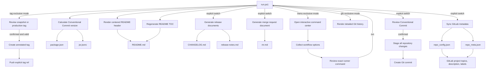

# glmeta

Glmeta provides repository metadata, release, GitLab, commit, and history automation for JavaScript repositories.

```text
          /$$                           /$$
          | $$                          | $$
  /$$$$$$ | $$ /$$$$$$/$$$$   /$$$$$$  /$$$$$$    /$$$$$$
 /$$__  $$| $$| $$_  $$_  $$ /$$__  $$|_  $$_/   |____  $$
| $$  \ $$| $$| $$ \ $$ \ $$| $$$$$$$$  | $$      /$$$$$$$
| $$  | $$| $$| $$ | $$ | $$| $$_____/  | $$ /$$ /$$__  $$
|  $$$$$$$| $$| $$ | $$ | $$|  $$$$$$$  |  $$$$/|  $$$$$$$
\____  $$|__/|__/ |__/ |__/ \_______/   \___/   \_______/
      /$$ /
|  $$$$$$/
 \______/
```

## Installation in consuming repositories

Add `glm.ps1` to the consuming repository root and ignore `/glmeta/`. The launcher clones `https://gitlab.com/staticcanvas/glmeta.git` on first use, unless `GLMETA_REPOSITORY_URL` provides another source, then forwards all arguments with the consuming repository root explicitly selected.

```powershell {title="glm.ps1"}
./glm.ps1 doctor
./glm.ps1 menu
./glm.ps1 prep-release -DryRun
```

Direct development invocation remains supported when the consuming repository is explicit:

```powershell {title="glmeta/run.ps1"}
./glmeta/run.ps1 -RepositoryRoot $PWD status
```

## Repository initialization

### Conceptual

Glmeta discovers the consuming repository with Git, so the cloned tool can live at any depth. Project-owned state remains at the repository root in `repo_config.json` and `repo_meta.json`; replacing or upgrading the cloned glmeta directory cannot overwrite that state. Generic initialization, JavaScript configuration, CI, and README-header templates remain under `templates/js`.

The idempotent initializer infers package, namespace, GitLab path, current branch, and display-name defaults. It creates only missing root files, validates an existing `repo_config.json`, and never overwrites either configuration file.

### Strict reference

```powershell {title="glm.ps1"}
./glm.ps1 init -DryRun
./glm.ps1 init
./glm.ps1 bootstrap -DryRun
./glm.ps1 bootstrap
```

## Local metadata chores

### Conceptual

Run `run.ps1` from any working directory inside the consuming Git repository. The default operation calculates the next version from Conventional Commits, synchronizes `package.json` and `jsr.jsonc`, rebuilds the templated `README.md` project header, regenerates its table of contents, and validates configured required headings. Release-document generation and remote GitLab synchronization are opt-in. The process does not modify `README-npm.md`. Output is separated into three colored sections: the gradient ASCII header, live LazyLog action messages, and the final execution report.

`jsheader.ps1` treats the existing leading aligned `<div>` block as a generated template. Alignment, project identity, repository and package paths, badge style, badge colors, URLs, and the active release tag are injected from repository configuration. The rendered description and the GitLab project description share `repo_meta.json` as their source.

`Test-ReadmeStructure.ps1` parses ATX headings outside fenced code blocks and compares normalized heading levels and names with `readme.requiredHeadings`. It prints a complete pass/missing report and does not reorder or rewrite authored sections.

### Strict reference

```powershell {title="glm.ps1"}
./glm.ps1
```

Preview local changes without writing files:

```powershell {title="glm.ps1"}
./glm.ps1 -DryRun
./glm.ps1 readme
```

Open the colored terminal manual, grouped by workflow with runnable examples beneath the parameter reference, or inspect one parameter in full:

```powershell {title="glmeta/help.ps1"}
./glm.ps1 help
./glm.ps1 help glo
./glm.ps1 help -Param Commit
./glm.ps1 -Help
./glmeta/help.ps1
./glmeta/help.ps1 -Param Commit
./glmeta/help.ps1 -Param glo
```

The version calculator uses the nearest reachable Git tag, matching the canonical `Get-ConventionalCommitVersion` behavior. It scans commits after that tag in Git log order and applies every Conventional Commit bump cumulatively. Each breaking change increments major, each feature increments minor, and each fix or performance commit increments patch while resetting lower components according to SemVer.

## Interactive command center

### Conceptual

The command center exposes every glmeta workflow through `Show-SMenu`. Menus are organized by task rather than raw switches: Prep Release, local metadata, release documents, merge-request generation and publication, GitLab metadata, Conventional Commits, tagging and publishing, Git history, and help. Each workflow collects only its relevant options, renders the exact `run.ps1` command, and requires a final Run or Back selection. The `[MA]` tag identifies a compound workflow that runs multiple glmeta actions; the tag appears on both its main-menu category and the exact compound submenu choices.

Action-specific workflows automatically skip unrelated local metadata work. Preview mode is the initial choice for release, merge-request, and GitLab operations. Remote label deletion defaults off. Escape cancels the current selection, returns to the prior screen, or exits at the main menu. The interface loads the display name from `repo_config.json`, contains no Lume-specific execution paths, and can move with the complete `glmeta` directory to another JavaScript repository.

`Show-SMenu` redraws by moving upward exactly the number of rows owned by the menu instead of relying on a terminal-global saved cursor. This prevents blocking and duplicated rows in PTYs, containers, SSH sessions, and nested prompts. Selected labels use a bold italic truecolor gradient and one additional left-padding column; descriptions use a separate subdued palette. Rows are measured before ANSI encoding, reserve the final terminal column, and truncate descriptions when required.

The command-center identity line assigns separate semantic colors to the project name, package name, and package version. Version-report bump inputs and repository status values use the same palette for major, minor, patch, clean, warning, and failure states.

### Strict reference

Open the command center with either supported form:

```powershell {title="glm.ps1"}
./glm.ps1 menu
./glm.ps1 -Menu
```

## Release preparation

### Conceptual

`prep-release` combines the frequently repeated local release operations. It calculates and synchronizes the cumulative Conventional Commit version, refreshes the root README header and table of contents, validates required README sections, finalizes the matching version and date in `CHANGELOG.md`, generates `release-notes.md`, and updates the ignored working `mr.md` document. `README-npm.md` remains authored separately but is included in the reviewed release-file commit selection when it has changed.

Preparation does not stage files by itself. Adding `-Commit` opens the normal patch review and selects only changed tracked files from `package.json`, `package-lock.json`, `jsr.jsonc`, `CHANGELOG.md`, `release-notes.md`, `README.md`, and `README-npm.md`.

### Strict reference

```powershell {title="glm.ps1"}
./glm.ps1 prep-release -DryRun
./glm.ps1 prep-release
./glm.ps1 prep-release -Commit
```

## Tagging and publishing

### Conceptual

`-Tag` is an exclusive action that calculates the next Conventional Commit version or accepts `-TagVersion`, then reviews an annotated tag targeting the current `HEAD`. Without `-Snapshot`, the generated production tag appends `-release`, such as `v0.28.0-release`, and starts validation, npm/JSR publishing, Pages deployment, generic-package generation, and the GitLab production release.

`-Snapshot` creates a plain SemVer tag such as `v0.28.0`. GitLab CI validates and builds the checkpoint without publishing packages or creating a production release. The `*-release` pattern can therefore be protected independently in GitLab.

Before publication, glmeta refreshes the configured remote and requires a clean worktree, an upstream branch that is not behind or diverged, matching manifest versions, and no conflicting tag. If the branch is locally ahead, the branch and tag are pushed atomically. A failed push removes a tag created by that attempt, while a matching pre-existing local tag can be retried. `-DryRun` reports blockers and `-TagForce` permits explicitly reviewed non-interactive automation. Existing unrelated tags are never pushed.

### Strict reference

Preview a calculated production tag:

```powershell {title="glm.ps1"}
./glm.ps1 -Tag -DryRun
```

Preview a validation-only snapshot tag:

```powershell {title="glm.ps1"}
./glm.ps1 -Tag -Snapshot -DryRun
```

Review and push an explicit production version:

```powershell {title="glm.ps1"}
./glm.ps1 -Tag -TagVersion 0.29.0
```

## Diagnostics and readiness

Use the read-only operational commands before commits or releases:

```powershell {title="glm.ps1"}
./glm.ps1 doctor
./glm.ps1 status
./glm.ps1 version
```

`doctor` validates dependencies, configuration, required files, commit defaults, and optional credentials. `status` summarizes worktree, upstream, version, and next tags. `version` explains the stable-tag baseline and the bump effect of every subsequent commit.

## Git history view

### Conceptual

`-glo` is an alias for the exclusive `-GitLog` mode. It is read-only and returns before version, README, release, remote, or commit actions can run. Each commit is rendered as one dense record containing its graph marker, abbreviated hash, ref decorations, ISO timestamp, relative age, author name and email, signature status, subject, changed-file count, insertions, deletions, binary-file count, and merge-parent count.

The history is surrounded by repository detail: current branch and HEAD, upstream tracking with ahead/behind counts, worktree state, aggregate author/merge/signature/change totals, and the complete changed-path list. The default limit is 25 commits. `-GitLogAll` traverses all refs and `-GitLogNoMerges` filters merges.

### Strict reference

Show the latest 25 commits:

```powershell {title="glm.ps1"}
./glm.ps1 -glo
```

Show 75 non-merge commits across all refs:

```powershell {title="glm.ps1"}
./glm.ps1 -glo -GitLogCount 75 -GitLogAll -GitLogNoMerges
```

## Conventional Commit workflow

### Conceptual

Pass `-Commit` to run the metadata actions and then open an interactive Conventional Commit workflow. `Show-SMenu` provides ordered type, scope, and file selection without clearing the terminal. Scope path patterns suggest the initial file selection. The review displays the exact subject, extracted release note, selected and excluded paths, diff totals, and patch before staging occurs. Confirming stages only the reviewed paths and creates one commit; declining leaves the index and working tree unchanged.

Commit types, scopes, and defaults are repository configuration rather than runner code, so the `tools/glmeta` directory can be copied to another JavaScript repository and adjusted in one JSON object. Explicit parameters support scripts and dry-run validation without keyboard menus.

### Strict reference

Open the interactive workflow after normal metadata maintenance:

```powershell {title="glm.ps1"}
./glm.ps1 -Commit
```

Preview a fully automated selection without staging files:

```powershell {title="glm.ps1"}
./glm.ps1 `
  -SkipVersion `
  -SkipReadmeMetadata `
  -SkipTableOfContents `
  -Commit `
  -CommitType feat `
  -CommitScope glmeta `
  -CommitDescription 'add interactive commit workflow' `
  -DryRun
```

## Changelog and release notes

### Conceptual

Release-document generation queries GitLab and reads non-merge commits after the newest release tag reachable from `HEAD`. Ordinary repository tags without a GitLab release are ignored. Conventional Commit types map to Added, Changed, Deprecated, Removed, Fixed, and Security. Non-conventional commit subjects are retained under Changed so the selected range is not silently incomplete. Every generated change includes its seven-character hash as a GitLab commit link and its Git author as an `@username` mention when the name is a valid GitLab username. Names containing spaces remain plain text. Pass `-IncludeCommitHash:$false` or `-IncludeAuthor:$false` to omit either field. `-CommitScope core` filters entries to the exact parsed `core` scope rather than matching arbitrary subject text.

Only content between `glmeta:changelog` and `glmeta:release-notes` markers is replaced. Text outside those markers remains manually editable. `release-notes.md` intentionally has no generated H1 because the CI release job nests its contents beneath the release description's `## Notes` heading. `-FromTag` overrides the automatic baseline with any Git ref that is an ancestor of `HEAD`, allowing a release to skip snapshot or intermediate releases. The override affects release documents only and never changes package-version calculation.

### Strict reference

Preview a draft from the latest reachable GitLab release tag:

```powershell {title="glm.ps1"}
./glm.ps1 `
  -SkipVersion `
  -SkipReadmeMetadata `
  -SkipTableOfContents `
  -UpdateReleaseDocs `
  -DryRun
```

Generate from an older explicit baseline:

```powershell {title="glm.ps1"}
./glm.ps1 `
  -SkipVersion `
  -SkipReadmeMetadata `
  -SkipTableOfContents `
  -UpdateReleaseDocs `
  -FromTag v0.25.0
```

Finalize a dated release section:

```powershell {title="glm.ps1"}
./glm.ps1 `
  -SkipVersion `
  -SkipReadmeMetadata `
  -SkipTableOfContents `
  -FinalizeRelease `
  -ReleaseVersion 0.28.0 `
  -FromTag v0.27.3
```

## Merge request document

### Conceptual

Merge-request generation uses the existing root `mr.md` as its working template. Because root `mr.md` is intentionally ignored by Git, a missing working file is seeded from the tracked `tools/glmeta/templates/mr.md` template. The generator updates the title, source branch, target branch, change range, and the marker-bounded Summary list while preserving manually maintained Compatibility, Validation, and Review notes. It also ensures the npm and JSR package-version task is the final item in the Release checklist.

Generated Summary items include the short commit hash followed by the commit author. These use the same default-on metadata switches as changelog and release-note generation.

### Strict reference

Update `mr.md` from the latest reachable stable SemVer tag:

```powershell {title="glm.ps1"}
./glm.ps1 `
  -SkipVersion `
  -SkipReadmeMetadata `
  -SkipTableOfContents `
  -UpdateMergeRequest
```

Generate without commit metadata and select the target branch explicitly:

```powershell {title="glm.ps1"}
./glm.ps1 `
  -SkipVersion `
  -SkipReadmeMetadata `
  -SkipTableOfContents `
  -UpdateMergeRequest `
  -MergeTargetBranch main `
  -IncludeCommitHash:$false `
  -IncludeAuthor:$false
```

## GitLab merge-request synchronization

### Conceptual

Glmeta can create a GitLab merge request from `mr.md` or update the matching open merge request. The title, source branch, target branch, and Markdown description remain document-driven. Create mode rejects an existing open request for the same branch pair; update mode requires exactly one match. Both modes read the configured token environment variable, hide the token from output, and enable source-branch removal after merge.

### Strict reference

```powershell {title="glm.ps1"}
./glm.ps1 -UpdateMergeRequest -CreateGitLabMergeRequest -DryRun
./glm.ps1 -UpdateMergeRequest -CreateGitLabMergeRequest
./glm.ps1 -UpdateMergeRequest -UpdateGitLabMergeRequest -DryRun
./glm.ps1 -UpdateMergeRequest -UpdateGitLabMergeRequest
```

## Script responsibilities

`run.ps1` is the supported entry point for routine use. Files under `scripts/` are focused implementation units and may also be dot-sourced or invoked directly when developing or diagnosing one action.

| Script                                                                           | Invocation  | Responsibility                                                                                                             |
| -------------------------------------------------------------------------------- | ----------- | -------------------------------------------------------------------------------------------------------------------------- |
| [`run.ps1`](run.ps1)                                                             | Direct      | Orchestrates local metadata actions, optional GitLab synchronization, live action logs, and the final report.              |
| [`help.ps1`](help.ps1)                                                           | Direct      | Renders the complete colored runner manual or detailed knowledge and examples for one parameter or alias.                  |
| [`Invoke-GlmetaMenu.ps1`](scripts/Invoke-GlmetaMenu.ps1)                         | Dot-sourced | Builds, reviews, and dispatches workflow-specific runner commands through Show-SMenu.                                      |
| [`Get-GlmetaConfiguration.ps1`](scripts/Get-GlmetaConfiguration.ps1)             | Dot-sourced | Loads root configuration, validates required fields, and resolves GitLab author mappings.                                  |
| [`Initialize-GlmetaRepository.ps1`](scripts/Initialize-GlmetaRepository.ps1)     | Dot-sourced | Creates missing root configuration from reusable JavaScript templates without overwriting existing state.                  |
| [`Test-ReadmeStructure.ps1`](scripts/Test-ReadmeStructure.ps1)                   | Dot-sourced | Reports required README heading presence while ignoring fenced-code examples.                                               |
| [`Get-ConventionalCommitVersion.ps1`](scripts/Get-ConventionalCommitVersion.ps1) | Dot-sourced | Finds the latest reachable stable tag and calculates the next SemVer version from Conventional Commits.                    |
| [`Update-JSLibSemver.ps1`](scripts/Update-JSLibSemver.ps1)                       | Dot-sourced | Applies one version to package.json, jsr.jsonc, and root package-lock.json package identities.                            |
| [`Update-ReleaseDocumentation.ps1`](scripts/Update-ReleaseDocumentation.ps1)     | Dot-sourced | Generates marker-bounded changelog and release-note sections from a validated Git range.                                  |
| [`Update-MergeRequestDocumentation.ps1`](scripts/Update-MergeRequestDocumentation.ps1) | Dot-sourced | Updates generated merge-request fields and its marker-bounded change list while preserving manual sections.       |
| [`Invoke-GitLabMergeRequest.ps1`](scripts/Invoke-GitLabMergeRequest.ps1)         | Dot-sourced | Creates or updates a GitLab merge request from the generated repository-root mr.md document.                       |
| [`Invoke-RepositoryCommit.ps1`](scripts/Invoke-RepositoryCommit.ps1)             | Dot-sourced | Builds, reviews, stages, and submits one repository-configured Conventional Commit.                                |
| [`Invoke-RepositoryTag.ps1`](scripts/Invoke-RepositoryTag.ps1)                   | Dot-sourced | Reviews, validates, creates, and explicitly pushes one snapshot or production tag.                                 |
| [`Write-PrettyGitLog.ps1`](scripts/Write-PrettyGitLog.ps1)                       | Dot-sourced | Renders dense per-commit records and repository, history, upstream, and worktree details.                           |
| [`Write-GlmetaVersionReport.ps1`](scripts/Write-GlmetaVersionReport.ps1)           | Dot-sourced | Explains the version baseline, result, and per-commit bump inputs.                                                   |
| [`Write-GlmetaRepositoryStatus.ps1`](scripts/Write-GlmetaRepositoryStatus.ps1)     | Dot-sourced | Displays read-only repository, upstream, worktree, version, and tag state.                                          |
| [`Test-GlmetaRepository.ps1`](scripts/Test-GlmetaRepository.ps1)                   | Dot-sourced | Validates local dependencies, required files, configuration, defaults, and optional credentials.                    |
| [`smenu.ps1`](scripts/smenu.ps1)                                                 | Dot-sourced | Returns a value from an ordered, cursor-controlled terminal selection menu.                                        |
| [`jsheader.ps1`](scripts/jsheader.ps1)                                           | Dot-sourced | Renders the reusable header template from root configuration, metadata, and the latest supported tag.                       |
| [`New-MarkdownTOC.ps1`](scripts/New-MarkdownTOC.ps1)                             | Dot-sourced | Generates headings and replaces only the content inside the existing collapsible table-of-contents block.                  |
| [`Sync-GitLabRepositoryMetadata.ps1`](scripts/Sync-GitLabRepositoryMetadata.ps1) | Direct      | Synchronizes the GitLab project description, topics, and managed project labels. Remote writes are opt-in.                 |
| [`asciitokenizer.ps1`](scripts/asciitokenizer.ps1)                               | Dot-sourced | Tokenizes ASCII art and renders the runner header with ANSI truecolor gradients.                                           |
| [`lazylog.ps1`](scripts/lazylog.ps1)                                             | Dot-sourced | Formats and writes the colored per-action log lines used by the runner and final report.                                   |

The header generator replaces only the leading `<div align="center">...</div>` block. The table-of-contents generator preserves its surrounding `<details>...</details>` element and replaces the generated list inside it.

## GitLab project metadata

### Conceptual

Remote synchronization is opt-in. The generator reads connection settings from `repo_config.json` and all descriptive project metadata from `repo_meta.json`. It requires `GITLAB_API_KEY` unless an access token is passed directly. Missing-label deletion remains disabled unless explicitly requested.

### Strict reference

Preview remote changes:

```powershell {title="glm.ps1"}
$env:GITLAB_API_KEY = '<token-from-secret-store>'
./glm.ps1 `
  -SkipVersion `
  -SkipReadmeMetadata `
  -SkipTableOfContents `
  -SyncGitLabMetadata `
  -DryRun
```

Apply remote metadata without deleting unmanaged labels:

```powershell {title="glm.ps1"}
./glm.ps1 `
  -SkipVersion `
  -SkipReadmeMetadata `
  -SkipTableOfContents `
  -SyncGitLabMetadata
```

## Layout

```text
tools/glmeta/
├── README.md
├── help.ps1               # Colored manual and per-parameter reference
├── run.ps1                # Public orchestration entry point
├── templates/
│   ├── mr.md              # Tracked seed for the ignored root merge-request document
│   └── js/                # Generic JS configuration, CI, and README templates
├── tests/
│   └── Glmeta.Tests.ps1   # Isolated Pester integration and unit coverage
└── scripts/
    ├── Get-GlmetaConfiguration.ps1
    ├── Get-ConventionalCommitVersion.ps1
    ├── Initialize-GlmetaRepository.ps1
    ├── Invoke-GlmetaMenu.ps1
    ├── Invoke-RepositoryCommit.ps1
    ├── Invoke-RepositoryTag.ps1
    ├── New-MarkdownTOC.ps1
    ├── asciitokenizer.ps1
    ├── lazylog.ps1
    ├── smenu.ps1
    ├── Update-JSLibSemver.ps1
    ├── Update-ReleaseDocumentation.ps1
    ├── Update-MergeRequestDocumentation.ps1
    ├── Write-PrettyGitLog.ps1
    ├── Write-GlmetaRepositoryStatus.ps1
    ├── Write-GlmetaVersionReport.ps1
    ├── Test-GlmetaRepository.ps1
    ├── Test-ReadmeStructure.ps1
    ├── jsheader.ps1
    └── Sync-GitLabRepositoryMetadata.ps1

repo_config.json           # Consuming repository identity, behavior, and README contract
repo_meta.json             # Consuming repository description, topics, and labels
```

`repo_meta.json` keeps each label's name, description, background color, and text color together. This avoids parallel arrays and removes the need to coordinate three separate catalogs.

## Execution flow



## API Reference

| Parameter             | Type                 | Default | Description                                                                              |
| --------------------- | -------------------- | ------- | ---------------------------------------------------------------------------------------- |
| `Command`             | `string`             | unset   | Supports `help`, `menu`, `init`, `bootstrap`, `prep-release`, `doctor`, `status`, `version`, and `readme`. |
| `Help`                | `switch`             | `false` | Opens the manual overview and exits without running metadata actions.                     |
| `Menu`                | `switch`             | `false` | Opens the reviewed interactive command center and exits normal runner initialization.     |
| `Init`                | `switch`             | `false` | Creates or validates repository-root configuration without replacing existing files.      |
| `Bootstrap`           | `switch`             | `false` | Initializes root configuration and then synchronizes configured GitLab metadata.           |
| `PrepRelease`         | `switch`             | `false` | Runs manifests, README, release-document, and merge-request preparation together.           |
| `Doctor`              | `switch`             | `false` | Runs read-only dependency and configuration checks.                                       |
| `Status`              | `switch`             | `false` | Shows read-only repository and release state.                                              |
| `VersionReport`       | `switch`             | `false` | Explains the stable baseline and Conventional Commit bump inputs.                          |
| `ValidateReadme`      | `switch`             | `false` | Runs the exclusive required-heading report.                                                |
| `HelpParameter` / `Param` | `string`          | unset   | Opens detailed help for one runner parameter or alias.                                    |
| `SkipVersion`         | `switch`             | `false` | Skips Conventional Commit version calculation and package manifest synchronization.      |
| `SkipReadmeMetadata`  | `switch`             | `false` | Skips centered README project-header generation.                                         |
| `SkipTableOfContents` | `switch`             | `false` | Skips canonical README table-of-contents generation.                                     |
| `SkipReadmeValidation` | `switch`            | `false` | Skips the required-heading contract during the default run.                               |
| `UpdateReleaseDocs`   | `switch`             | `false` | Updates marker-bounded draft changelog and release-note content.                         |
| `FinalizeRelease`     | `switch`             | `false` | Generates release documents under the dated version heading; implies release-doc update. |
| `UpdateMergeRequest`  | `switch`             | `false` | Updates generated fields and the managed change list in `mr.md`.                          |
| `CreateGitLabMergeRequest` | `switch`        | `false` | Creates a GitLab merge request from `mr.md`; rejects a duplicate open branch pair.         |
| `UpdateGitLabMergeRequest` | `switch`        | `false` | Updates the matching open GitLab merge request from `mr.md`.                               |
| `ReleaseVersion`      | `string`             | package version | Overrides the version displayed in generated release documents.                     |
| `FromTag`             | `string`             | action-specific | Uses a reachable historical ref; release documents use the latest GitLab release, while `mr.md` uses the latest stable tag. |
| `MergeTargetBranch`   | `string`             | `main`  | Sets the target branch displayed in generated `mr.md`.                                    |
| `IncludeCommitHash`   | `switch`             | `true`  | Adds each short commit hash to generated change-list items; `:$false` disables it.        |
| `IncludeAuthor`       | `switch`             | `true`  | Adds each author after the commit hash; `:$false` disables it.                            |
| `SyncGitLabMetadata`  | `switch`             | `false` | Enables remote GitLab topics, description, and label synchronization.                    |
| `DeleteMissingLabels` | `switch`             | `false` | Deletes remote labels absent from the catalog; effective only with `SyncGitLabMetadata`. |
| `Commit`              | `switch`             | `false` | Opens the review workflow after successful runner actions.                               |
| `CommitType`          | `string`             | interactive/configured | Bypasses type selection with a Conventional Commit type.                         |
| `CommitScope`         | `string`             | interactive/configured | Bypasses scope selection; `none` omits the scope.                                |
| `CommitDescription`   | `string`             | interactive/configured | Bypasses the description prompt with a single-line description.                  |
| `CommitFiles`         | `string[]`           | interactive selection | Selects exact changed paths to stage and commit.                                          |
| `CommitAll`           | `switch`             | `false` | Selects every changed path while retaining review and confirmation.                       |
| `Tag`                 | `switch`             | `false` | Runs the exclusive reviewed tag creation and push workflow.                               |
| `Snapshot`            | `switch`             | `false` | Creates a plain SemVer validation tag; requires `Tag`.                                    |
| `TagForce`            | `switch`             | `false` | Allows non-interactive publication while retaining all safety checks.                     |
| `TagVersion`          | `string`             | calculated | Overrides the tag version with stable MAJOR.MINOR.PATCH; requires `Tag`.                |
| `GitLog` / `glo`      | `switch`             | `false` | Runs the exclusive read-only detailed Git history view.                                   |
| `GitLogCount`         | `integer`            | `25`    | Limits history output from 1 through 500 commits.                                         |
| `GitLogAll`           | `switch`             | `false` | Reads commits reachable from all local and remote refs.                                   |
| `GitLogNoMerges`      | `switch`             | `false` | Omits merge commits from history output.                                                  |
| `RepositoryRoot`      | `string`             | current directory | Selects the consuming Git repository independently of the glmeta checkout.       |
| `ConfigPath`          | `string`             | root `repo_config.json` | Overrides configuration discovery without changing repository discovery.        |
| `DryRun`              | `switch`             | `false` | Reports local and remote changes without applying them.                                  |
| `GITLAB_API_KEY`      | environment variable | unset   | GitLab token used only when remote synchronization is requested.                         |

Every operation writes an activity message before work starts and a success or failure message when it ends. The final report repeats the outcome of each operation using green for completion, gray for skipped work, and red for failures. Padding is calculated before ANSI encoding. `Format-LazyLog` returns a composable string, while `Write-LazyLog` emits the live action messages.

### Configuration Reference

| File               | Field                   | Type       | Description                                                                                                        |
| ------------------ | ----------------------- | ---------- | ------------------------------------------------------------------------------------------------------------------ |
| `repo_config.json` | `project`               | `object`   | Project name, display name, namespace, repository/artifact paths, packages, branch, banner, and documentation URL. |
| `repo_config.json` | `readmeHeader`          | `object`   | Header alignment, badge style, colors, and Codecov token used by `jsheader.ps1`.                                  |
| `repo_config.json` | `readme.requiredHeadings` | `object[]` | Required Markdown heading level/name pairs validated by `readme` and default runs.                             |
| `repo_config.json` | `commit.defaultType`    | `string`   | Initially selected type in the interactive commit menu.                                                          |
| `repo_config.json` | `commit.defaultScope`   | `string`   | Initially selected scope in the interactive commit menu.                                                         |
| `repo_config.json` | `commit.defaultDescription` | `string` | Description used when the prompt is accepted without input.                                                   |
| `repo_config.json` | `authors.mappings`     | `array`    | Maps Git author email addresses to GitLab usernames for reliable profile mentions.                            |
| `repo_config.json` | `commit.types`          | `object[]` | Ordered type names and menu descriptions.                                                                        |
| `repo_config.json` | `commit.scopes`         | `object[]` | Ordered scope names and menu descriptions; include `none` to support an unscoped subject.                         |
| `repo_config.json` | `tagging.prefix`        | `string`   | Prefix prepended to tag versions; defaults to `v`.                                                              |
| `repo_config.json` | `tagging.releaseSuffix` | `string`  | Suffix appended to production tags; configured as `-release`.                                                 |
| `repo_config.json` | `tagging.remote`        | `string`   | Git remote receiving the explicit new tag ref.                                                                  |
| `repo_config.json` | `gitlab`                | `object`   | GitLab base URI, project ID, and token environment-variable name.                                                  |
| `repo_config.json` | `metadataSource`        | `string`   | Metadata file path relative to the configuration file.                                                             |
| `repo_config.json` | `labelScope`            | `string`   | Supported value is `project`.                                                                                      |
| `repo_config.json` | `requestTimeoutSeconds` | `integer`  | GitLab API request timeout.                                                                                        |
| `repo_meta.json`   | `project.description`   | `string`   | Shared README header and GitLab project description; must begin with the configured display name followed by `is`. |
| `repo_meta.json`   | `project.topics`        | `string[]` | Authoritative GitLab topic list.                                                                                   |
| `repo_meta.json`   | `labels`                | `object[]` | Managed label name, description, background color, and text color records.                                         |
