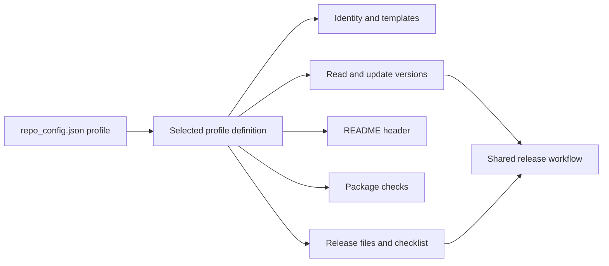

# Repository profiles

Profiles define repository packaging conventions while Rivet retains the shared Git and documentation workflow.

## Adding a makeup

Create `profiles/<name>/profile.ps1` inside the Rivet installation. Names use lowercase
letters, digits, and hyphens, beginning with a letter. The resolver loads exactly the
selected file and expects one hashtable containing the handlers below. There is no
central registry, language switch, or module export list to update.

For example, start a Ruby gem profile by copying the existing PowerShell profile in a
Rivet development checkout (Bash):

```bash
cp -R profiles/psm profiles/gem
```

Then change the copied handlers and templates to implement gem manifest discovery,
version reading and writing, package checks, and README rendering. Replace `psm`
configuration references with the new profile's settings. Do not leave the PowerShell
manifest parser in a gem handler. The copied configuration template's `{{PROFILE}}`
token already saves the selected name. This is an extension recipe; a gem profile is
not included in Rivet yet.

Preview the completed profile from a consuming repository (PowerShell):

```powershell
./rivet.ps1 init -Profile gem -DryRun
```

Use `profiles/jsm/profile.ps1` when adapting JavaScript conventions. Its template root
points to the existing `templates/js` directory for compatibility. PowerShell's shipped
templates live under `profiles/psm/templates`; `templates/psm` is not used by the runtime.

## Responsibilities

The core owns configuration loading, Git history and version calculation, file creation,
TOC generation, heading validation, changelogs, merge requests, commit review, and tag
publication. Profiles own how those operations interact with a package format.



Handler scriptblocks receive arguments positionally as listed below. They should use
those arguments and Rivet helpers rather than capturing variables from the definition
script. Resolve `TemplateRoot` with `$PSScriptRoot` when constructing the hashtable;
it is evaluated while the definition file is loaded.

`ValidateConfig` runs whenever Rivet loads configuration. It validates settings without
requiring the package files to exist yet. File checks belong in `Checks` or the manifest
reader. Invalid configuration and unknown profiles fail before workflow writes.

Only `UpdateVersion` and `UpdateHeader` write profile-managed content during normal
maintenance. They must honor `DryRun`, preserve unrelated content, and throw on invalid
input. Initialization writes the files returned by `Templates`, preserving existing
files. Do not execute builds or publish packages from a profile handler. Build and
deployment configuration remain with the repository's existing tooling.

For an operation that intentionally does nothing, supply a scriptblock with the documented
parameters and an empty body. Do not silently skip required manifest validation.
`ReleaseChecklist` must return the common checklist wording below or the legacy JavaScript
wording so repeated merge-request updates can replace the managed line:

```powershell
# Inside profiles/<name>/profile.ps1
ReleaseChecklist = {
    param($Version)
    "- [ ] Update repository manifest versions to ``$Version``."
}
```

## Compatibility and validation

Missing `profile` selects `jsm`. Empty and unknown names are errors. `-Profile` and
`-Manifest` are initialization options; established repositories use configuration.
The profile name identifies the primary release artifact, not every language present.
For example, JavaScript files in a `psm` repository do not enable JavaScript version updates.

Test each new profile using temporary repositories: initialization and repeat initialization,
dry-run with no writes, malformed or ambiguous manifests, preservation of unrelated content,
doctor checks, release preparation, and tag version mismatches. Include a repository with
incidental tooling from another language. Run the existing JavaScript regressions as well.

The current regression suite includes a temporary third profile to exercise discovery and
router dispatch without registering that profile in core code. From the Rivet checkout:

```powershell
Invoke-Pester ./tests/Rivet.Tests.ps1
```

## API reference

### Configuration and initialization

| Field or option | Type | Default / contract |
| --- | --- | --- |
| `profile` | string | `jsm` when absent; installed lowercase name matching `^[a-z][a-z0-9-]*$` |
| `psm.manifest` | string | Required for `psm`; repository-relative `.psd1` path within the repository |
| `-Profile` | string | Existing configuration profile, otherwise `jsm`; init/bootstrap only |
| `-Manifest` | string | Profile-specific initialization input; `psm` infers a single root module manifest or scaffolds `<project>.psd1` |
| `-Bun` | switch | JavaScript initialization only |
| `TemplateRoot` | string | Existing absolute template directory; defined in `profile.ps1` |

### Profile handlers

Every listed handler is required and must be a scriptblock.

| Handler | Positional arguments | Result / responsibility |
| --- | --- | --- |
| `ValidateConfig` | Config | Throw on invalid profile settings; no output or writes |
| `Identity` | RepositoryRoot, ProjectName, Namespace, Manifest | Hashtable with `ProjectName`, `Namespace`, and `Tokens` hashtable |
| `Templates` | RepositoryRoot, Tokens, Bun | Sequence of template entries described below; no writes |
| `ReadVersion` | RepositoryRoot, Config | Primary manifest version string |
| `UpdateVersion` | RepositoryRoot, Config, Version, DryRun | Update package versions; optional status text |
| `UpdateHeader` | RepositoryRoot, Config, ConfigPath, DryRun | Update the managed header; optional status text |
| `Checks` | RepositoryRoot, Config | Call the core-provided `Add-Check Name Passed Detail Required`; no output or writes |
| `ReviewVersions` | RepositoryRoot, Config | Strings `relative/path=version` for every manifest that must match a proposed tag |
| `ReleaseFiles` | RepositoryRoot, Config | Exact repository-relative paths using `/`; no globs |
| `ReleaseChecklist` | Version | One managed Markdown checklist line |

The core adds `README.md`, `CHANGELOG.md`, `release-notes.md`, and
`docs/data/changelog.json` to release-file selection. Profiles return only their extra
files. `ReviewVersions` determines which versions block tagging when they disagree
with the proposed version. It should throw when a required manifest is unreadable.

### Template entries and tokens

| Entry field | Type | Contract |
| --- | --- | --- |
| `File` | string | Repository-relative destination; supports token replacement |
| `Template` | string | Source path relative to `TemplateRoot` |
| `TokenReplace` | bool | Replace initialization tokens in template contents |
| `Mandatory` | bool | Throw if the source template is missing |
| `RivetManaged` | bool | Resolve through Rivet path discovery; `repo_config.json` honors `-ConfigPath` |

Built-in identity tokens are `{{PROFILE}}`, `{{PROJECT_NAME}}`, `{{DISPLAY_NAME}}`,
`{{NAMESPACE}}`, `{{PROJECT_PATH}}`, and `{{DEFAULT_BRANCH}}`. `Identity.Tokens` adds
format-specific values. JavaScript adds `{{PACKAGE_NAME}}`. PowerShell adds
`{{MANIFEST}}`, `{{MODULE_NAME}}`, `{{MODULE_FILE}}`, and `{{MODULE_GUID}}`.
